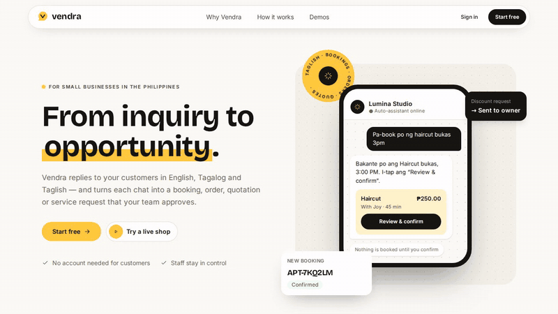

# Vendra — From inquiry to opportunity

Vendra is a business assistant for small businesses in the Philippines. Its offline auto-assistant answers customer
questions in English, Tagalog and Taglish, staff take over any chat, then turns them into **bookings, orders, quotations and service
requests** that staff can trust.

[](https://github.com/ashweak/vendra/actions/workflows/tests.yml)

**Interactive demo (fictional data, runs in the browser):** https://ashweak.github.io/vendra/ ·
**Case study:** https://ashweak.github.io/vendra/case-study.html

[](https://render.com/deploy?repo=https://github.com/ashweak/vendra)



[Watch the walkthrough as MP4](https://raw.githubusercontent.com/ashweak/vendra/recording/vendra-demo.mp4) — recorded
from the real app in GitHub Actions on every change to the script.

> **Status:** local build for demonstrations with **fictional data only**. It is not production-ready; see
> [docs/SCOPE_CHANGES.md](docs/SCOPE_CHANGES.md) for the milestone status and the decisions recorded against the
> approved plan.

## What it does

**Customers** (no account needed)
- Branded business page with a searchable catalog, hours, policies and FAQ.
- **Six website themes** (Studio, Coral, Ocean, Roastery, Slate, Market), each with its own homepage layout,
  header and footer, that the owner picks during setup and
  can switch anytime in *Settings → Appearance*, with a live preview of their real page before saving.
- Booking, ordering, quotation and service-request forms. Every submission goes **form → review → confirm**.
  Double-clicks and refreshes never create duplicates.
- Chat with an offline auto-assistant that answers from the business's live data and prepares a **draft** the customer reviews in the
  form. Typing in chat never submits anything.
- "Track my request": a single-use, expiring email link. A reference number alone never shows private data.

**Business dashboard** (owner / manager / staff, enforced server-side)
- Inbox with *Auto-assistant* → *Waiting for staff* → *Staff active* → *Closed* states, handoff summaries, internal notes,
  assignment, and explicit "Resume auto-replies".
- Appointments: staff schedules, slot availability, locked double-booking checks, approval deadlines with
  expiry, walk-in/phone entries in the same calendar, safe rescheduling, no-shows.
- Orders: stock is reserved on submission, deducted once at handover, and released on cancel or expiry. Delivery
  fees are reviewed by staff. Payment verification is separate and done only by staff.
- Quotations: immutable versions, owner approval before sending, acceptance tied to a specific version,
  one-time conversion to a service request.
- Service requests, customers with consent history and privacy requests, reports (submitted, confirmed and completed shown
  separately), activity log, CSV exports, team and schedules, onboarding checklist, closure with a 30-day
  export window.

**Platform admin**
- Accounts, plans and usage records, verified Vendra fee payments, suspension, and an admin log.
- **No access to business content** unless the owner grants a time-limited, logged, revocable support grant.

**Auto-assistant rules** (P6)
- No outside AI service: the rules engine runs on the server, so customer messages never leave Vendra.
- It uses only controlled tools: business info, catalog search, availability, draft preparation and
  handoff.
- It cannot book, order, change prices or stock, give discounts, verify payments, or read other customers'
  records.
- Monthly limits per business, rate and concurrency limits, and an owner warning at 80%.
- Forms and staff replies keep working when auto-replies are off, at their limit, or failing.
- It checks the conversation state before replying, so it never replies over a staff member who took over.

## Tech

Laravel 13 (PHP ≥ 8.3) · Blade · Tailwind CSS 4 (precompiled) · MySQL or SQLite · Laravel scheduler ·
offline rules engine (English, Tagalog, Taglish).

## Host the live demo for free (Render)

The repo includes a `Dockerfile` and a `render.yaml` Blueprint for Render's free web service plan. Check
Render's current free-plan terms before you start; nothing in this setup uses a paid service.

1. Click **Deploy to Render** above and sign in with GitHub.
2. Review the `vendra-demo` service (Docker, **Free** plan) and click **Deploy Blueprint**.
3. After the first build (about 5–8 minutes), open the `https://vendra-demo-xxxx.onrender.com` URL Render gives you.
   The sign-in page lists one-click demo accounts.

What to expect: public demo mode (`VENDRA_PUBLIC_DEMO=true`) reseeds **fictional data on every start**, the free
instance sleeps after 15 idle minutes and takes about a minute to wake, and the auto-assistant runs offline
(no API key). Owner MFA is off in demo mode so visitors can sign in. CI builds the same image and smoke-tests
pages, the chat and sign-in on every push.

Run the image yourself: `docker build -t vendra . && docker run -p 8080:10000 -e VENDRA_PUBLIC_DEMO=true -e VENDRA_ENFORCE_MFA=false vendra`

## Run it locally (WSL Ubuntu)

```bash
git clone https://github.com/ashweak/vendra.git ~/projects/vendra
cd ~/projects/vendra
composer install
cp .env.example .env
php artisan key:generate
```

Choose a database in `.env`:

- **MySQL (plan default).** Create the database and user first:
  ```bash
  sudo mysql -e "CREATE DATABASE vendra; CREATE USER 'vendra'@'localhost' IDENTIFIED BY 'change-me'; GRANT ALL ON vendra.* TO 'vendra'@'localhost';"
  ```
  Then set `DB_PASSWORD=change-me`.
- **SQLite (quickest).** Set `DB_CONNECTION=sqlite`, remove the `DB_DATABASE` line, and run
  `touch database/database.sqlite`.

Then:

```bash
php artisan migrate --seed           # fictional demo data
php artisan serve                    # http://localhost:8000
php artisan schedule:work            # second terminal: expiry + retention jobs
```

Emails (tracking links, staff alerts) are written to `storage/logs/laravel.log`. No real email is sent.

### Demo accounts (password: `password`)

| Business | Owner | Others |
|---|---|---|
| Lumina Hair & Nail Studio (`/b/lumina-studio`) — appointments, quotations | owner@lumina.test | manager@lumina.test, joy@lumina.test, ken@lumina.test (staff) |
| Ganda Beauty Hub (`/b/ganda-beauty`) — orders | owner@ganda.test | |
| Kislap Home Cleaning (`/b/kislap-cleaning`) — service requests, quotations, appointments | owner@kislap.test | |
| Platform admin | admin@vendra.test | |

Owners and the admin must set up an authenticator app (TOTP) on first sign-in. For a quick local demo only, you
can set `VENDRA_ENFORCE_MFA=false`.

### Tests and assistant evaluation

```bash
php artisan test                                   # 71 feature + unit tests
php artisan migrate:fresh --seed
php artisan vendra:ai-eval          # 60 fictional EN/TL/Taglish cases (add --show to print replies)
```

Pass criteria (P11): ≥95% of ordinary cases and 100% of the critical privacy, permission and integrity cases.
The results describe these cases only and do not guarantee future behavior.

### Why there is no Gemini or other cloud AI

An earlier version could call Gemini's free tier. It was removed because Google's terms for unpaid use allow
submitted content to be used to improve its products and reviewed by people, which isn't acceptable for real
customers' messages. The offline rules engine costs nothing and keeps every message on the server.

## Cost rule

This project uses free tools and local infrastructure. Nothing here buys services or activates live customer
use. That needs a committed customer, a budget review and the production gate in the plan.

## Project map

```
app/Services/            Appointment, Order, Quotation, ServiceRequest, Conversation, CustomerAccess, AuditLogger
app/Services/Ai/         AssistantService, AssistantTools (controlled functions), RuleBasedProvider, DateParser
app/Http/Controllers/    PublicController (customer page), ChatController, Dashboard/*, Admin/*
app/Support/             PermissionMatrix (P4), Totp (MFA), CurrentBusiness (tenant), Money
app/Console/Commands/    vendra:expire, vendra:retention, vendra:ai-eval
tests/ai-eval/cases.json 60 fictional evaluation cases
docs/SCOPE_CHANGES.md    decisions and milestone status
Dockerfile, docker/      production image (Apache + PHP 8.4 + SQLite) used by render.yaml
scripts/                 screenshots.mjs and record.mjs (Playwright, run in GitHub Actions)
```

---
Built by Lance Ashley Agua · BSIT, Our Lady of Fatima University
